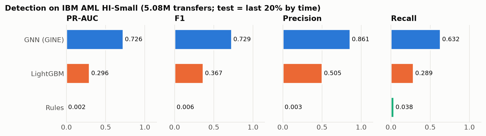
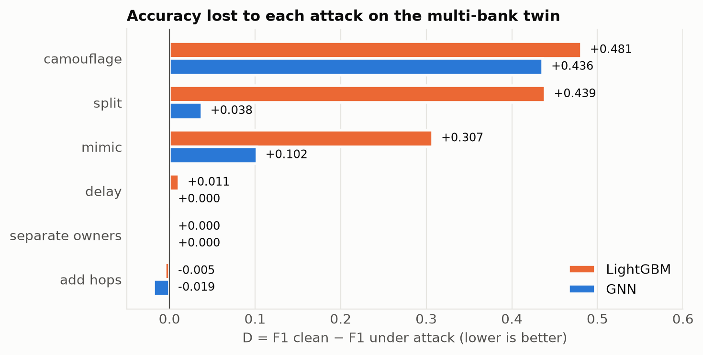
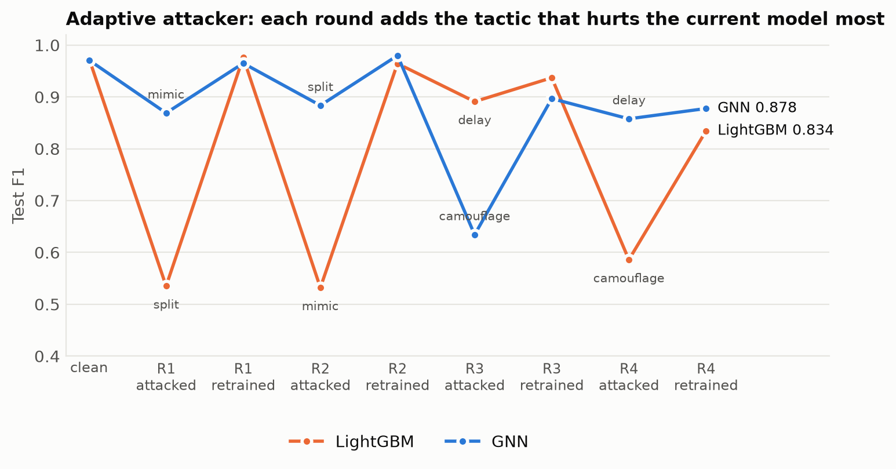
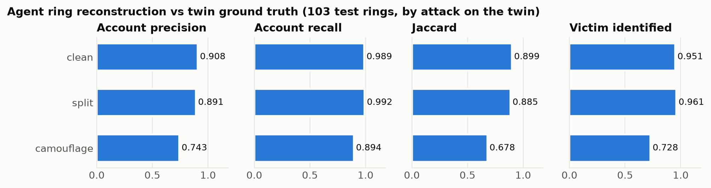

# ARGUS — results pack

All numbers are produced by the scripts in this repo; figures in this folder are generated by `scripts/make_figures.py`. Twin results are a single seed.

## Table 1 — Detection on IBM AML HI-Small (test = last 20% by time)

| Model | PR-AUC | F1 | Precision | Recall | Ring recall @1 | Ring recall @0.5 |
|---|---|---|---|---|---|---|
| Rules | 0.002 | 0.006 | 0.003 | 0.038 | 0.005 | 0.010 |
| LightGBM | 0.296 | 0.367 | 0.505 | 0.289 | 0.042 | 0.370 |
| GNN (GINE, time-respecting) | 0.726 | 0.729 | 0.861 | 0.632 | 0.604 | 0.901 |

## Table 2 — Single-operator attacks on the twin (D = degradation, R = recovery, F1)

| Attack | LightGBM attacked | LightGBM retrained | LightGBM D | LightGBM R | GNN attacked | GNN retrained | GNN D | GNN R |
|---|---|---|---|---|---|---|---|---|
| *(clean)* | 0.974 | — | — | — | 0.971 | — | — | — |
| separate_owners | 0.974 | 0.974 | +0.000 | +0.000 | 0.971 | 0.969 | +0.000 | -0.002 |
| add_hops | 0.979 | 0.998 | -0.005 | +0.019 | 0.990 | 1.000 | -0.019 | +0.010 |
| split | 0.535 | 0.976 | +0.439 | +0.441 | 0.933 | 0.986 | +0.038 | +0.053 |
| delay | 0.963 | 0.965 | +0.011 | +0.002 | 0.971 | 0.967 | +0.000 | -0.004 |
| mimic | 0.667 | 0.961 | +0.307 | +0.294 | 0.869 | 0.965 | +0.102 | +0.096 |
| camouflage | 0.493 | 0.823 | +0.481 | +0.330 | 0.535 | 0.848 | +0.436 | +0.313 |

## Table 3a — Adaptive attacker vs LightGBM

| Round | Tactic added | F1 before | F1 attacked | F1 retrained | D | R |
|---|---|---|---|---|---|---|
| 1 | split | 0.974 | 0.535 | 0.976 | +0.439 | +0.441 |
| 2 | mimic | 0.976 | 0.532 | 0.964 | +0.444 | +0.432 |
| 3 | delay | 0.964 | 0.891 | 0.937 | +0.073 | +0.046 |
| 4 | camouflage | 0.937 | 0.586 | 0.834 | +0.351 | +0.248 |

## Table 3b — Adaptive attacker vs GNN

| Round | Tactic added | F1 before | F1 attacked | F1 retrained | D | R |
|---|---|---|---|---|---|---|
| 1 | mimic | 0.971 | 0.869 | 0.965 | +0.102 | +0.096 |
| 2 | split | 0.965 | 0.883 | 0.980 | +0.081 | +0.096 |
| 3 | camouflage | 0.980 | 0.634 | 0.897 | +0.346 | +0.263 |
| 4 | delay | 0.897 | 0.858 | 0.878 | +0.039 | +0.020 |

## Table 4 — Agent ring reconstruction (103 test rings, LightGBM scores)

| Twin | Rings detected | Precision | Recall | Jaccard | Victim identified |
|---|---|---|---|---|---|
| clean | 103/103 | 0.908 | 0.989 | 0.899 | 0.951 |
| split | 103/103 | 0.891 | 0.992 | 0.885 | 0.961 |
| camouflage | 103/103 | 0.743 | 0.894 | 0.678 | 0.728 |

## Figures

